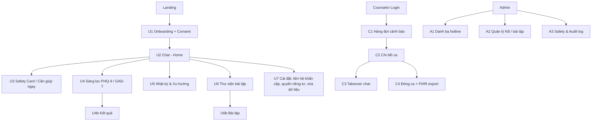
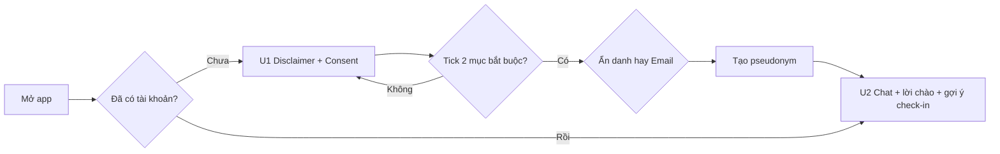
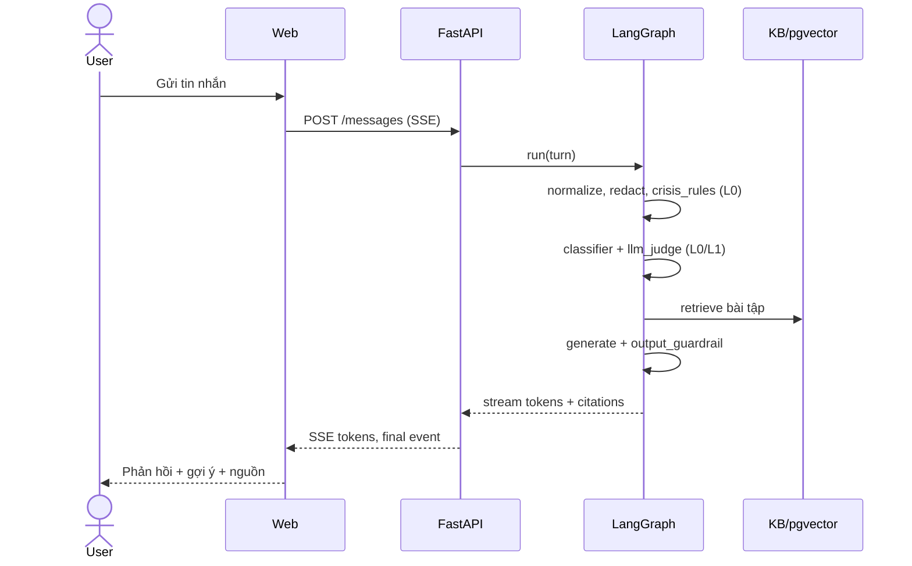
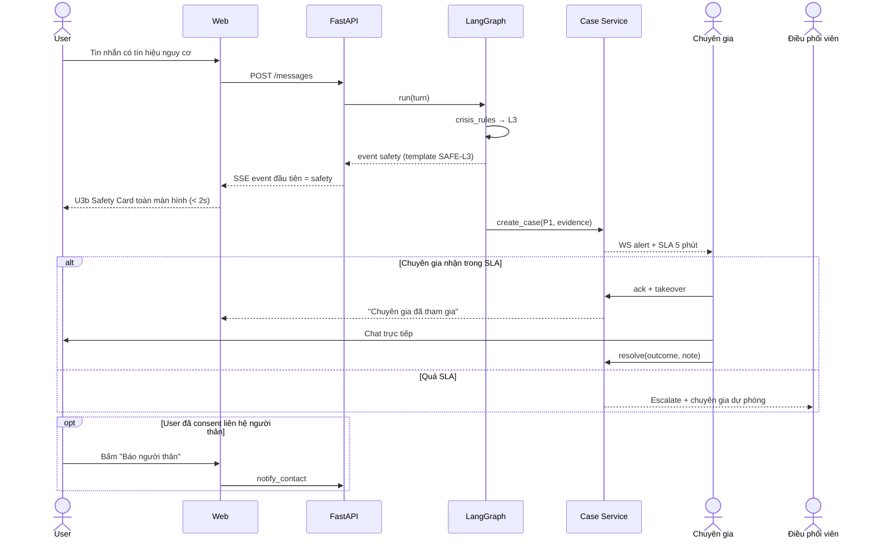
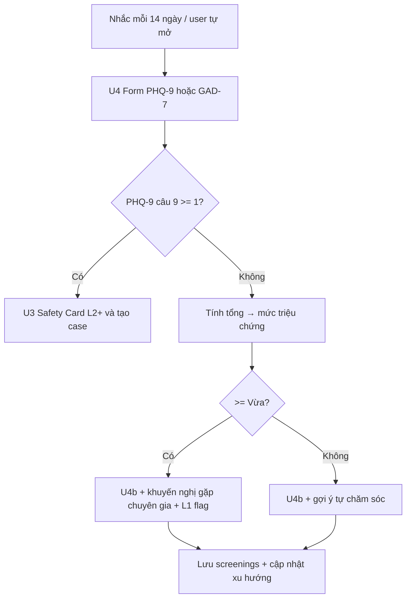
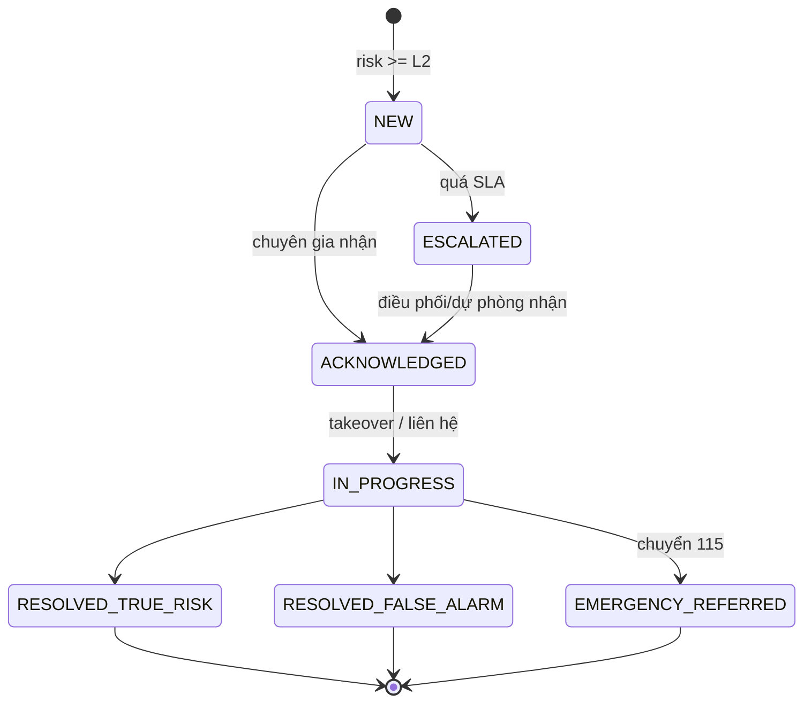

# 03 — WIREFRAME & UI FLOW: BÌNH AN

| Trường | Giá trị |
|---|---|
| Phiên bản | v0.1 — Lo-fi wireframe, Gate 1 |
| Ngày | 2026-11-15 |
| Liên quan | [PRD](02-PRD.md) (mã màn hình map sang Epic E1–E9) |
| Thiết bị ưu tiên | User: **mobile-first** (360–430px) · Counselor/Admin: desktop (≥ 1280px) |

**Nguyên tắc UI an toàn:**
1. Nút **"Cần giúp ngay"** cố định ở header trên **mọi** màn hình user, bấm 1 lần là mở danh bạ hotline.
2. Footer disclaimer cố định trong chat.
3. Màu khủng hoảng dùng tông **cam đậm/đỏ ấm**, tránh đỏ báo lỗi gây hoảng. Chữ trên nền khủng hoảng đạt tương phản ≥ 7:1.
4. Trang hotline là **trang tĩnh**, xem được cả khi offline hoặc backend down (Service Worker cache).
5. Kết quả sàng lọc không bao giờ hiện tên bệnh.

---

## 1. Sitemap



---

## 2. Wireframes — User (mobile)

### U1. Onboarding + Consent

```
┌──────────────────────────────┐
│  🌿 Bình An                   │
│                              │
│  Xin chào, mình là Bình An — │
│  người bạn đồng hành AI.     │
│                              │
│  ┌──────────────────────────┐│
│  │ ⚠ Mình KHÔNG phải bác sĩ ││
│  │ hay nhà trị liệu.        ││
│  │ • Không chẩn đoán bệnh   ││
│  │ • Không kê/tư vấn thuốc  ││
│  │ • Khẩn cấp: gọi 115      ││
│  └──────────────────────────┘│
│                              │
│  [✓] Tôi đồng ý Điều khoản * │
│  [✓] Đồng ý xử lý dữ liệu    │
│      sức khỏe (ẩn danh) *    │
│  [ ] Cho phép liên hệ người  │
│      thân khi khẩn cấp       │
│      (tùy chọn, sửa sau được)│
│                              │
│  ( Tiếp tục ẩn danh )        │
│  ( Đăng nhập bằng email )    │
└──────────────────────────────┘
```

### U2. Chat — Home

```
┌──────────────────────────────┐
│ ☰  Bình An      [🆘 Cần giúp]│  ← header cố định
├──────────────────────────────┤
│ ┌──────────────────────────┐ │
│ │ 📋 Đã 14 ngày, bạn muốn   │ │  ← nhắc sàng lọc (E3-4)
│ │ làm check-in nhanh?  [Có]│ │
│ └──────────────────────────┘ │
│                              │
│        Dạo này mình ngủ ┐    │
│        không được, áp   │    │
│        lực thi quá ─────┘    │
│                              │
│ ┌─ Bình An ───────────────┐  │
│ │ Nghe như mấy hôm nay bạn │  │
│ │ vừa thiếu ngủ vừa chịu   │  │
│ │ áp lực lớn. Điều gì làm  │  │
│ │ bạn lo nhất lúc này?     │  │
│ │                          │  │
│ │ 💡 Thử: Thở hộp 4-4-4-4  │  │
│ │    [Bắt đầu 2 phút]      │  │
│ │ 📚 Nguồn: kb-breath-004  │  │  ← citation bắt buộc
│ └──────────────────────────┘  │
│                              │
│ [😊 Ghi tâm trạng] [🧘 Bài tập]│  ← quick actions
├──────────────────────────────┤
│ [ Nhập tin nhắn...      ] [➤]│
│ AI không thay thế chuyên gia.│  ← footer disclaimer
│ Khẩn cấp gọi 115.            │
└──────────────────────────────┘
```

### U3. Safety Card — L2 (inline, ghim ở đầu chat)

```
┌──────────────────────────────┐
│ ☰  Bình An      [🆘 Cần giúp]│
├──────────────────────────────┤
│ ╔══════════════════════════╗ │
│ ║ 🧡 Bạn không một mình     ║ │
│ ║                          ║ │
│ ║ Cảm ơn bạn đã chia sẻ.   ║ │
│ ║ Điều bạn đang trải qua   ║ │
│ ║ rất nặng nề, và bạn xứng ║ │
│ ║ đáng được giúp ngay.     ║ │
│ ║                          ║ │
│ ║ [📞 Gọi đường dây hỗ trợ]║ │  ← từ DB hotlines đã xác minh
│ ║ [👩‍⚕️ Kết nối chuyên gia ]║ │  ← tạo/gắn case
│ ║ [📞 115 — Cấp cứu      ]║ │
│ ║                          ║ │
│ ║ Bước an toàn ngay lúc này:║ │
│ ║ 1. Ở gần người bạn tin   ║ │
│ ║ 2. Tránh xa vật nguy hiểm║ │
│ ║ 3. Thở chậm cùng mình    ║ │
│ ╚══════════════════════════╝ │
│                              │
│ ┌─ Bình An ───────────────┐  │
│ │ Mình vẫn ở đây với bạn.  │  │  ← template follow-up
│ │ Bạn có đang an toàn ngay │  │
│ │ lúc này không?           │  │
│ │ [Có] [Không chắc] [Không]│  │
│ └──────────────────────────┘  │
└──────────────────────────────┘
```

### U3b. Safety Card — L3 (toàn màn hình, không đóng bằng tap ra ngoài)

```
┌──────────────────────────────┐
│                              │
│   🧡 Mình lo cho bạn.         │
│   Hãy để người thật giúp bạn │
│   ngay bây giờ.              │
│                              │
│  ┌────────────────────────┐  │
│  │  📞  GỌI 115 NGAY       │  │  ← nút lớn nhất
│  └────────────────────────┘  │
│  ┌────────────────────────┐  │
│  │  📞  Đường dây hỗ trợ   │  │
│  └────────────────────────┘  │
│  ┌────────────────────────┐  │
│  │  👨‍👩‍👧 Báo người thân:   │  │  ← chỉ hiện khi có consent
│  │      "Chị Mai"          │  │
│  └────────────────────────┘  │
│                              │
│  Chuyên gia đã được thông    │
│  báo và sẽ tham gia sớm.     │  ← case P1 đã tạo
│                              │
│  ( Tôi đang an toàn lúc này )│  ← lối ra rõ ràng
│  ( Nói chuyện với chuyên gia)│
└──────────────────────────────┘
```

### U4. Sàng lọc (PHQ-9) → U4b Kết quả

```
┌──────────────────────────────┐     ┌──────────────────────────────┐
│ ← Check-in tâm trạng   3/9   │     │ ← Kết quả check-in            │
│ ▓▓▓▓▓▓░░░░░░░░░              │     │                              │
│                              │     │ PHQ-9 (mô phỏng): 12/27      │
│ Trong 2 tuần qua, bạn có     │     │ Mức triệu chứng: VỪA         │
│ thường gặp vấn đề sau không: │     │ ░░░░░▓▓▓▓░░░░░░              │
│                              │     │                              │
│ "Khó ngủ, ngủ không sâu      │     │ ⚠ Đây KHÔNG phải chẩn đoán.  │
│  hoặc ngủ quá nhiều"         │     │                              │
│                              │     │ 💬 Mức này bạn nên trò chuyện│
│ ( ) Không hề                 │     │ với chuyên gia tâm lý.       │
│ ( ) Vài ngày                 │     │ [Kết nối chuyên gia]         │
│ (•) Hơn nửa số ngày          │     │                              │
│ ( ) Gần như mỗi ngày         │     │ Trong lúc chờ, thử:          │
│                              │     │ • Vệ sinh giấc ngủ 📚        │
│ [Bỏ qua]          [Tiếp →]   │     │ • Nhật ký suy nghĩ CBT 📚    │
│ Phiên bản mô phỏng, không    │     │                              │
│ phải công cụ chẩn đoán.      │     │ [Xem xu hướng] [Về chat]     │
└──────────────────────────────┘     └──────────────────────────────┘
```
*Câu 9 trả lời ≥ 1 thì bỏ qua màn kết quả, hiện thẳng U3 (Safety Card L2+) — E3-3.*

### U5. Nhật ký & Xu hướng (P1)

```
┌──────────────────────────────┐
│ ← Nhật ký cảm xúc            │
│ Hôm nay bạn thấy thế nào?    │
│  😞   🙁   😐   🙂   😄       │
│ Tag: [Học tập][Giấc ngủ][+]  │
│ [ Ghi chú (tùy chọn)...    ] │
│                    [Lưu]     │
├──────────────────────────────┤
│ Xu hướng  [7d][30d][90d]     │
│ 5 ┤        ●                 │
│ 4 ┤   ●  ●   ●     ●         │
│ 3 ┤ ●          ● ●   ●       │
│ 2 ┤                          │
│   └─────────────────────     │
│   ◆ PHQ-9: 14 → 12 → 9       │
│ 💡 Tâm trạng thường thấp hơn │
│    vào ngày ngủ < 6h.        │  ← insight mô tả, không chẩn đoán
└──────────────────────────────┘
```

### U6. Thư viện bài tập → U6b Bài tập thở

```
┌──────────────────────────────┐     ┌──────────────────────────────┐
│ ← Bài tập tự chăm sóc        │     │ ← Thở hộp 4-4-4-4            │
│ [Tất cả][Thở][CBT][Ngủ][...] │     │                              │
│ ┌──────────────────────────┐ │     │         ┌───────┐            │
│ │🫁 Thở hộp       2 phút  │ │     │         │  HÍT  │            │
│ │   Giảm căng thẳng nhanh  │ │     │         │   3   │            │
│ └──────────────────────────┘ │     │         └───────┘            │
│ ┌──────────────────────────┐ │     │   ◯ Hít 4s  ◯ Giữ 4s         │
│ │🧠 Nhật ký suy nghĩ CBT   │ │     │   ◯ Thở 4s  ◯ Giữ 4s         │
│ └──────────────────────────┘ │     │                              │
│ ┌──────────────────────────┐ │     │ Vòng 2/4        [⏸ Tạm dừng] │
│ │🌱 Grounding 5-4-3-2-1    │ │     │                              │
│ └──────────────────────────┘ │     │ 📚 Nguồn: <tổ chức, link>    │
│ ⭐ Gợi ý cho bạn (P1)         │     │ Sau bài tập bạn thấy: 😞→😄   │
└──────────────────────────────┘     └──────────────────────────────┘
```

---

## 3. Wireframes — Counselor (desktop)

### C1. Hàng đợi cảnh báo

```
┌──────────────────────────────────────────────────────────────────────────────┐
│ Bình An · Console chuyên gia        🔔 3 mới    ThS. Hà (online ●)   [Đăng xuất]│
├───────────────┬──────────────────────────────────────────────────────────────┤
│ ▸ Hàng đợi (3)│  Lọc: [Tất cả ▾] [Chưa nhận ▾]                  Sắp xếp: Level│
│   Đang xử lý 1│ ┌────┬──────────┬─────────────────────────┬────────┬─────────┐│
│   Đã đóng     │ │Lvl │ Bí danh  │ Tín hiệu (evidence)     │ SLA    │         ││
│   Thống kê    │ ├────┼──────────┼─────────────────────────┼────────┼─────────┤│
│               │ │🔴L3│ user-7f2 │ "…tối nay mình sẽ…"     │ ⏱ 03:12│ [Nhận]  ││
│               │ │🟠L2│ user-a91 │ PHQ-9 câu 9 = 2         │ ⏱ 11:40│ [Nhận]  ││
│               │ │🟠L2│ user-c03 │ "ước gì biến mất"       │ ⏱ 14:05│ [Nhận]  ││
│               │ └────┴──────────┴─────────────────────────┴────────┴─────────┘│
│               │  ⚠ Quá SLA sẽ tự escalate lên điều phối viên                  │
└───────────────┴──────────────────────────────────────────────────────────────┘
```

### C2. Chi tiết ca → C3 Takeover → C4 Đóng ca

```
┌──────────────────────────────────────────────────────────────────────────────┐
│ ← Ca #9f2 · user-7f2 · 🔴 L3 · Trạng thái: ĐÃ NHẬN (ThS. Hà, 10:42)          │
├──────────────────────────────────────┬───────────────────────────────────────┤
│ 🤖 AI Summary (đã che PII)            │ 💬 Hội thoại (redacted)    [Takeover] │
│ Người dùng chia sẻ áp lực học tập     │ 10:38 U: dạo này mệt lắm               │
│ kéo dài 3 tuần, mất ngủ; lượt gần     │ 10:39 AI: Nghe như bạn…                │
│ nhất có biểu hiện kế hoạch cụ thể.    │ 10:41 U: ░░░tối nay mình sẽ░░░ ←hl    │
│ ⚠ AI không chẩn đoán, chỉ tóm tắt.    │ 10:41 [SAFETY CARD L3 hiển thị]        │
│                                      │ 10:42 U bấm "Nói chuyện với chuyên gia"│
│ 🧪 Lớp phát hiện                      │                                       │
│ • Rules: CR-KW-031 (plan+time)       │ ┌───────────────────────────────────┐ │
│ • Classifier: L3 (0.94)              │ │ [ Nhập tin với tư cách chuyên gia ]│ │
│ • LLM judge: imminent_plan           │ └───────────────────────────────────┘ │
│                                      │                                       │
│ 📈 PHQ-9: 14 → 18 (7 ngày)           │ Hành động:                            │
│ 💊 Cảnh báo thuốc: —                 │ [📞 Gọi user*] [🚑 Escalate 115]       │
│ 👤 Liên hệ KC: có consent [Mở🔒]      │ [👥 Báo người thân] [✅ Đóng ca]       │
│    (break-glass, ghi audit)          │ [⬇ Xuất FHIR R4]                      │
└──────────────────────────────────────┴───────────────────────────────────────┘
 * chỉ khi user đã cung cấp và đồng ý

 Modal Đóng ca (C4):  Kết luận: (•) Nguy cơ thật  ( ) Báo động giả  ( ) Đã chuyển cấp cứu
                      Ghi chú: [__________]   Hạ level phiên: [L1 ▾]   [Xác nhận]
```

### A1. Admin — Danh bạ hotline

```
┌──────────────────────────────────────────────────────────────────────────┐
│ Admin · Danh bạ đường dây nóng                                   [+ Thêm] │
├────────────────────────┬──────────────┬──────────┬─────────────┬─────────┤
│ Tên                    │ Số           │ Giờ      │ Xác minh    │         │
├────────────────────────┼──────────────┼──────────┼─────────────┼─────────┤
│ Cấp cứu                │ 115          │ 24/7     │ ✅ 2026-11-15│ [Sửa]  │
│ Hỗ trợ trầm cảm        │ 096 306 1414 │ ?        │ ⚠ Chưa      │ [Xác minh]│
└────────────────────────┴──────────────┴──────────┴─────────────┴─────────┘
  ⚠ Mục quá 30 ngày chưa xác minh sẽ bị đánh dấu đỏ
```

---

## 4. UI Flows

### F1. Onboarding



### F2. Một lượt chat bình thường (L0/L1)



### F3. Khủng hoảng → Escalation (CORE)



### F4. Sàng lọc định kỳ



### F5. Vòng đời ca (Case lifecycle)



---

## 5. Ma trận màn hình ↔ yêu cầu

| Màn hình | Epic | Ưu tiên | Ghi chú cho FE |
|---|---|---|---|
| U1 | E1 | P0 | Lưu consent version |
| U2 | E2, E3-4 | P0 | SSE, render citation chip |
| U3 / U3b | E4 | **P0 — blocker** | Render từ event `safety`, không chờ token LLM; dùng được offline |
| U4 / U4b | E3 | P0 | Ngưỡng điểm lấy từ config backend |
| U5 | E6 | P1 | Chart: line, a11y có bảng dữ liệu thay thế |
| U6 / U6b | E2-2 | P0 (list) / P1 (cá nhân hóa) | Animation thở có tôn trọng `prefers-reduced-motion` |
| U7 | E1-4, E7 | P0 (xóa dữ liệu) / P1 (liên hệ KC) | |
| C1–C4 | E5, E8-3 | P0/P1 | WebSocket, SLA timer phía server |
| A1–A3 | §3.3, E9-2 | P0 (A1) / P1 | |

**Bước tiếp theo:** chuyển lo-fi sang hi-fi (Figma) cho U2, U3, U3b, C1, C2 trước Sprint 1. Usability test nhanh U3/U3b với 5 người `[SYNTHETIC persona]`.
