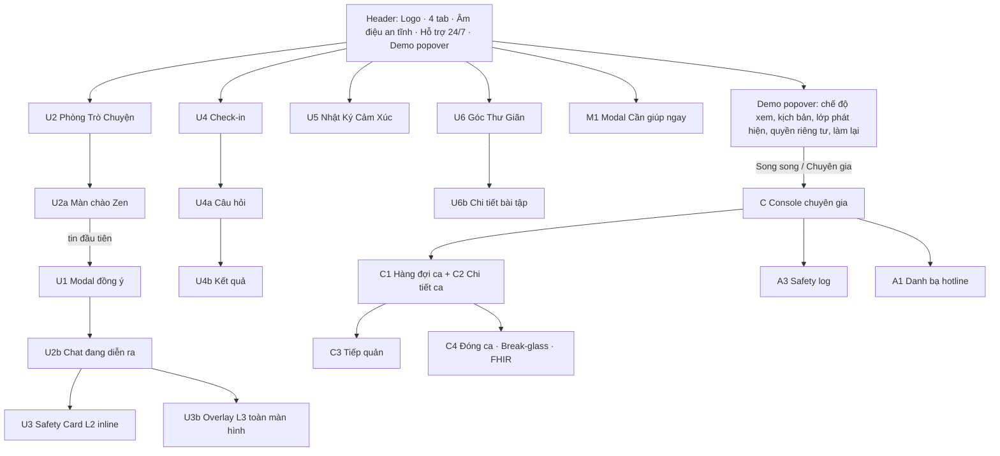
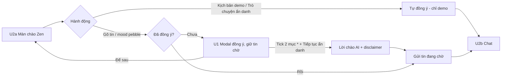
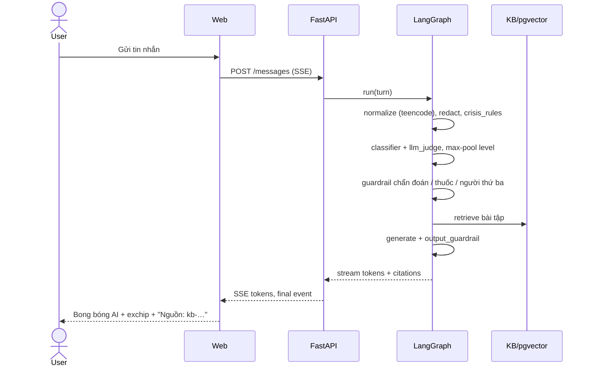
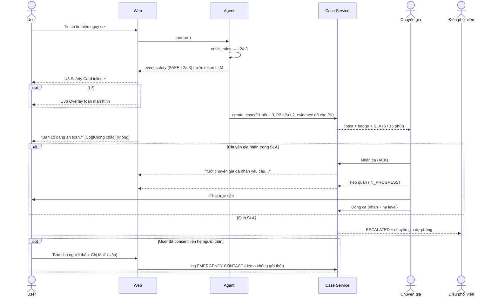
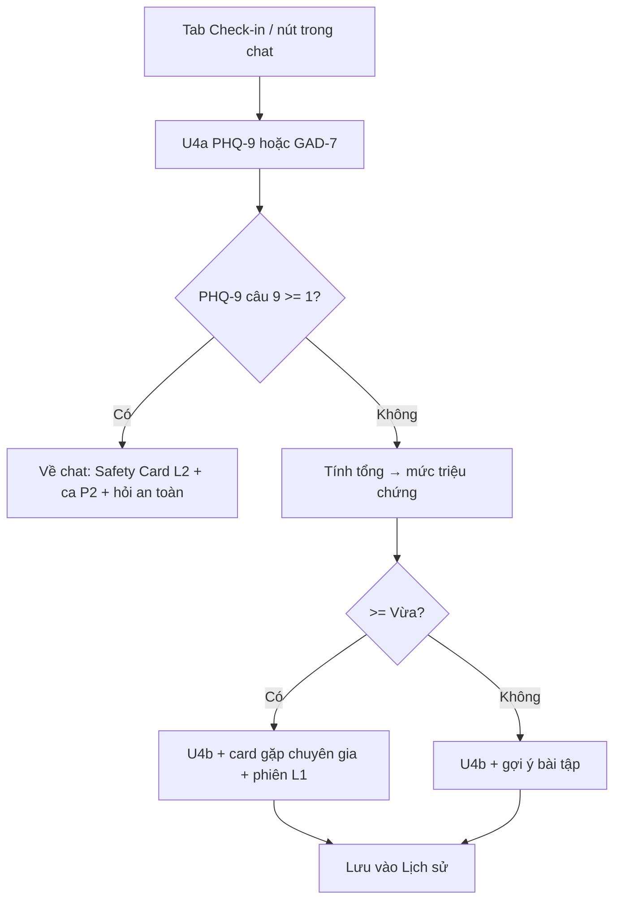
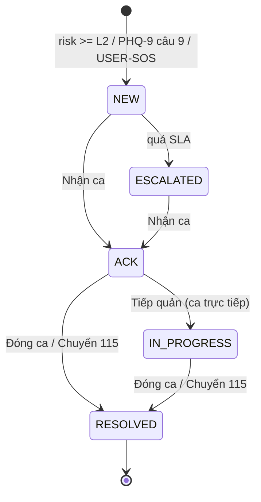

# 03 — WIREFRAME & UI FLOW: BÌNH AN

| Trường | Giá trị |
|---|---|
| Phiên bản | v0.2 — Đồng bộ theo demo HTML (`demo/index.html`), Gate 1 |
| Ngày | 2026-11-15 |
| Liên quan | [PRD](02-PRD.md) (mã màn hình map sang Epic E1–E9) · [Architecture & ADR](04-ARCHITECTURE.md) · [Demo](../demo/index.html) |
| Thiết bị | Single-page app, responsive: user ưu tiên mobile (header xuống 2 hàng khi ≤ 900px) · console chuyên gia dùng desktop (chế độ Song song ≥ 1040px) |

> v0.2 vẽ lại wireframe theo đúng giao diện demo. Những gì PRD có mà demo **chưa** làm được liệt kê ở §6, không vẽ như thể đã có.

**Nguyên tắc UI an toàn (đối chiếu demo):**
1. Nút **"Hỗ trợ 24/7"** cố định ở header, bấm 1 lần mở modal *Cần giúp ngay* với danh bạ hotline. Footer có thêm link "Khẩn cấp gọi 115".
2. Disclaimer cố định dưới ô nhập trong chat: *"Bình An hỗ trợ ban đầu, không chẩn đoán hay thay thế chuyên gia. Khẩn cấp gọi 115."*
3. Màu khủng hoảng dùng tông cam đậm/đỏ ấm (`--crisis`), không dùng đỏ báo lỗi. Mục tiêu tương phản chữ ≥ 7:1 `[UNVERIFIED — chưa đo trên demo]`.
4. Danh bạ hotline là dữ liệu tĩnh (`HOTLINES` trong demo, bảng `hotlines` ở bản thật), LLM không sinh số. Số chưa xác minh có nhãn *"demo, chưa xác minh"*. Cache offline bằng Service Worker là yêu cầu của bản thật, demo chưa có.
5. Kết quả sàng lọc chỉ hiện điểm và **mức độ triệu chứng**, không hiện tên bệnh, luôn kèm câu *"Đây không phải chẩn đoán."*

---

## 1. Sitemap

Toàn bộ chạy trong một trang. Header điều hướng 4 tab user; console chuyên gia hiện theo **chế độ hiển thị** chọn trong popover Demo.



### Chế độ hiển thị (popover Demo → "Chế độ hiển thị")

| Chế độ | `#stage[data-view]` | Bố cục |
|---|---|---|
| Người dùng | `user` | Chỉ user pane, rộng tối đa 960px |
| Song song | `split` | User pane (≤ 500px) + console; ≤ 1040px xếp dọc |
| Chuyên gia | `counselor` | Chỉ console, rộng tối đa 1360px. Bấm tab user ở header sẽ tự chuyển về Song song |

---

## 2. Khung chung

### Nền không gian an tĩnh (`#leavesContainer` & `.bg-weave`)
- `.bg-weave`: các vòng tròn đồng tâm mờ trôi chậm quanh viền trang web.
- `#leavesContainer`: hiệu ứng lá rơi tự nhiên mặc định (tối đa 3 lá đồng thời, nhịp ~4.5–6.5 giây/lá, tự dọn DOM và tạm dừng khi `document.hidden` qua `visibilitychange` để tránh dồn lá khi chuyển tab).

### Header

```
Desktop (> 900px)
┌────────────────────────────────────────────────────────────────────────────────────┐
│ (lá) Bình An [SYNTHETIC]  Phòng Trò Chuyện · Góc Thư Giãn · Nhật Ký Cảm Xúc · Check-in │
│                                  [♫ Âm điệu an tĩnh]  [♥ Hỗ trợ 24/7]  [👤 Demo ③] │
└────────────────────────────────────────────────────────────────────────────────────┘

Mobile (≤ 900px): nav xuống hàng 2, ẩn chữ "Âm điệu an tĩnh" và nhãn chế độ
┌────────────────────────────────────────────┐
│ (lá) Bình An      [♫] [♥ Hỗ trợ 24/7] [👤③] │
├────────────────────────────────────────────┤
│ Phòng Trò Chuyện · Góc Thư Giãn · Nhật Ký… │
└────────────────────────────────────────────┘
```
- `③` = badge số ca chưa nhận (`#topBadge`), đồng bộ với badge tab Hàng đợi.
- **Âm điệu an tĩnh**: bật/tắt âm nền Web Audio (4 sóng sine, fade in/out), `aria-pressed`.

### Popover Demo (`#demoPopover`)

```
┌─────────────────────────────────────────┐
│ CHẾ ĐỘ HIỂN THỊ                         │
│ ( Người dùng | Song song | Chuyên gia ) │
│ KỊCH BẢN KIỂM THỬ NHANH                 │
│ [Mất ngủ L0][Lo âu L0][Kiệt sức L1]     │
│ [Phủ định L0][Nói gián tiếp L2]         │
│ [Teencode L2][Có kế hoạch L3]           │
│ [Cờ đỏ y khoa L3][Người thứ ba]         │
│ [Mồi chẩn đoán][Hỏi liều thuốc]         │
│ ─────────────────────────────────────── │
│ [ ] Lớp phát hiện   [Quyền riêng tư][Làm lại]│
└─────────────────────────────────────────┘
```
- Chip kịch bản tự đồng ý (bỏ qua U1) rồi gửi câu mẫu vào chat — chỉ phục vụ demo.
- "Lớp phát hiện" bật hiển thị trace (level, rule, classifier, judge, nhãn guardrail) dưới tin nhắn.

### Footer (`.site-footer`) và thanh trạng thái

```
│ 🛡 Bảo mật ẩn danh • Không chẩn đoán hay kê đơn • Dữ liệu mô phỏng [SYNTHETIC] │
│ 📞 Khẩn cấp gọi 115 • Đường dây hỗ trợ 24/7   ← mở M1                          │
```
Hai thanh có thể xuất hiện ở đầu user pane:
- `#pinned` (khi level phiên ≥ L2): *"Tài nguyên an toàn luôn ở đây cho bạn"* `[Mở ngay]` → M1.
- `#takeoverBar` (khi chuyên gia tiếp quản): *"ThS. Hà (chuyên gia) đang trò chuyện cùng bạn. Bình An tạm dừng."*

### M1. Modal "Cần giúp ngay"

```
┌──────────────────────────────────────┐
│ Cần giúp ngay                        │
│ Danh bạ hotline tĩnh, xem được ngay  │
│ cả khi gián đoạn kết nối.            │
│ Cấp cứu y tế · 24/7        115 [Chép][Gọi]│
│ "Ngày Mai" · Chưa rõ ·               │
│   demo, chưa xác minh  096 306 1414 [Chép][Gọi]│
│ Bảo vệ trẻ em · 24/7       111 [Chép][Gọi]│
│ Công an · 24/7             113 [Chép][Gọi]│
│ [Nói chuyện với chuyên gia]  [Đóng]  │
└──────────────────────────────────────┘
```
"Nói chuyện với chuyên gia" → nếu chưa có ca thì tạo ca **P2** (rule `USER-SOS`), nâng phiên lên L2, ghim `#pinned`, gửi yêu cầu tới chuyên gia.

---

## 3. Wireframes — User

### U2a. Phòng Trò Chuyện — màn chào Zen (chưa có tin nhắn)

```
┌──────────────────────────────┐
│            ( ☀ )             │
│  Chào bạn, hôm nay bạn cảm   │
│  thấy thế nào?               │
│  Không gian luôn lắng nghe   │
│  và đồng hành cùng bạn...    │
│                              │
│ [🌿 Mệt mỏi] [☁️ Lạc lõng]    │  ← mood pebbles, bấm = gửi câu mẫu
│ [💬 Cần ai đó lắng nghe]      │
│ [🍃 Muốn tĩnh lặng]           │
│                              │
│ [ Hãy chia sẻ bất kỳ điều gì… ] [→]│
│                              │
│ 🌿 Thực hành thở 2 phút •    │  ← mở U6b Thở hộp
│ 💭 Trò chuyện ẩn danh •      │  ← vào chat trống
│ 💛 Kết nối chuyên viên       │  ← như M1 "Nói chuyện với chuyên gia"
│                              │
│ (🔒 Hoàn toàn ẩn danh • Mã hóa│  ← mở U1
│     riêng tư • Không phán xét)│
└──────────────────────────────┘
```

### U1. Modal đồng ý (lazy consent)

Không có màn onboarding riêng. Modal chỉ hiện khi người dùng **gửi tin đầu tiên** (tin được giữ lại, gửi tiếp sau khi đồng ý) hoặc bấm trust pill / "Quyền riêng tư".

```
┌──────────────────────────────────────┐
│ Trước khi trò chuyện ẩn danh         │
│ Bình An là người bạn AI lắng nghe    │
│ và hỗ trợ ban đầu.                   │
│ ┌──────────────────────────────────┐ │
│ │ Mình không phải bác sĩ hay nhà   │ │
│ │ trị liệu.                        │ │
│ │ • Không chẩn đoán bệnh           │ │
│ │ • Không kê hay tư vấn liều thuốc │ │
│ │ • Đang gặp nguy hiểm: gọi 115    │ │
│ └──────────────────────────────────┘ │
│ [ ] Tôi đồng ý Điều khoản sử dụng *  │
│ [ ] Đồng ý xử lý dữ liệu sức khỏe ở  │
│     dạng ẩn danh *                   │
│ [ ] Cho phép liên hệ người thân khi  │
│     khẩn cấp (tùy chọn · Chị Mai)    │
│ [Tiếp tục ẩn danh]  [Để sau]         │  ← nút chính disabled tới khi tick đủ 2 mục *
└──────────────────────────────────────┘
```
Sau khi đồng ý: AI chào kèm nhắc *"Mình không phải bác sĩ… gọi 115"*. Demo chưa có đăng nhập email.

### U2b. Chat đang diễn ra

```
┌──────────────────────────────┐
│ ┌─ Bình An ───────────────┐  │
│ │ Chào bạn, mình là Bình An│  │
│ │ … Nếu bạn đang gặp nguy  │  │
│ │ hiểm, hãy gọi 115.       │  │
│ └──────────────────────────┘  │
│        ┌─────────────────────┐│
│        │ Dạo này mình mất    ││
│        │ ngủ, áp lực thi quá ││
│        └─────────────────────┘│
│        L0 · cls 0.07 · judge  │  ← trace, chỉ khi bật "Lớp phát hiện"
│        no_risk                │
│ ┌─ Bình An ───────────────┐  │
│ │ Nghe như mấy hôm nay bạn │  │
│ │ vừa thiếu ngủ vừa phải   │  │
│ │ gồng mình… Điều gì hay   │  │
│ │ khiến bạn trằn trọc nhất?│  │
│ └──────────────────────────┘  │
│ [Thử: Thở hộp 4-4-4-4 · 2 phút]│  ← exchip → U6b
│ Nguồn: kb-breath-004 · tài   │  ← citation bắt buộc
│ liệu demo, chờ cố vấn duyệt  │
├──────────────────────────────┤
│ [ Bạn muốn chia sẻ điều gì? ] [→]│
│ Bình An hỗ trợ ban đầu, không│  ← disclaimer cố định
│ chẩn đoán… Khẩn cấp gọi 115. │
└──────────────────────────────┘
```

Các biến thể tin AI (nhãn guardrail chỉ hiện khi bật "Lớp phát hiện"):

| Kích hoạt | Phản hồi | Thành phần thêm |
|---|---|---|
| L1 (kiệt sức, vô vọng) | Đồng cảm + khuyên gặp chuyên gia | exchip Thở hộp + nút `[Làm check-in PHQ-9]` |
| Mồi chẩn đoán (`ADV-DX`) | Từ chối chẩn đoán, gợi ý PHQ-9 | nút `[Làm check-in PHQ-9]` |
| Hỏi liều thuốc | Không tư vấn liều, hỏi bác sĩ/dược sĩ | Nếu SSRI + tramadol: thêm cảnh báo, log `DDI-SSRI-TRAMADOL`, báo console |
| Người thứ ba | Hướng dẫn hỗ trợ người khác | Hotline 115 + 096 306 1414 |
| Phủ định ("không có ý định…") | Không leo thang, hỏi tiếp | exchip |
| Chuyên gia tiếp quản | AI im lặng, tin ≥ L2 vẫn đổ vào ca | Bong bóng "ThS. Hà · chuyên gia" |

### U3. Safety Card — L2 (inline trong luồng chat)

```
┌──────────────────────────────┐
│ Tài nguyên an toàn luôn ở đây│  ← #pinned
│ cho bạn            [Mở ngay] │
├──────────────────────────────┤
│ ╔══════════════════════════╗ │
│ ║ Bạn không một mình       ║ │
│ ║ Cảm ơn bạn đã tin tưởng  ║ │
│ ║ chia sẻ. Điều bạn đang   ║ │
│ ║ trải qua rất nặng nề…    ║ │
│ ║ "Ngày Mai" 096 306 1414  ║ │  ← hotRows: [Chép][Gọi]
│ ║ Cấp cứu y tế  115        ║ │
│ ║ [ Kết nối chuyên gia ]   ║ │
│ ║ 1. Ở gần một người bạn   ║ │
│ ║    tin tưởng             ║ │
│ ║ 2. Để những vật có thể   ║ │
│ ║    gây hại ra xa         ║ │
│ ║ 3. Thở chậm cùng mình:   ║ │
│ ║    hít 4s, thở ra 6s     ║ │
│ ╚══════════════════════════╝ │
│ ┌─ Bình An ───────────────┐  │
│ │ Mình vẫn ở đây với bạn.  │  │
│ │ Bạn có đang an toàn ngay │  │
│ │ lúc này không?           │  │
│ └──────────────────────────┘  │
│ [Có] [Không chắc] [Không]    │  ← trả lời 1 lần rồi khóa
└──────────────────────────────┘
```
- Card render **trước** tin AI (trace: *event safety gửi trước token LLM · template SAFE-L2-v3*).
- Ở L3 card vẫn chèn vào chat (115 lên đầu), đồng thời mở U3b.
- Biến thể cờ đỏ y khoa: tiêu đề *"Đây có thể là tình huống cấp cứu"*, bỏ 3 bước an toàn.
- Trả lời an toàn: **Có** → AI mời thở 2 phút · **Không chắc** → log `SAFE-CHECK-UNSURE`, ưu tiên ca · **Không** → nâng L3 (`SAFE-CHECK-NO`), thêm card L3 + mở U3b.

### U3b. Overlay L3 (toàn màn hình, `role="alertdialog"`, không đóng khi bấm ra ngoài)

```
┌──────────────────────────────┐
│  Mình lo cho bạn.            │  ← cờ đỏ y khoa: "Bạn cần được
│  Hãy để người thật giúp bạn  │     cấp cứu ngay."
│  ngay bây giờ.               │
│ ┌──────────────────────────┐ │
│ │ Gọi cấp cứu         115  │ │  ← nút lớn nhất, nhận focus
│ └──────────────────────────┘ │
│ "Ngày Mai" 096 306 1414 [Chép][Gọi]│
│ [Báo cho người thân: Chị Mai]│  ← chỉ khi có consent liên hệ
│ Chuyên gia của Bình An đã    │
│ được thông báo và sẽ tham gia│
│ sớm.                         │
│ [ Nói chuyện với chuyên gia ]│  ← crisis
│ [ Tôi đang an toàn lúc này ] │  ← lối ra, ghi system msg
└──────────────────────────────┘
```

### U4. Check-in → U4a Câu hỏi → U4b Kết quả

```
U4 Danh sách                 U4a Câu hỏi                   U4b Kết quả
┌──────────────────────┐    ┌──────────────────────┐     ┌──────────────────────┐
│ Check-in tâm trạng   │    │[← Quay lại] PHQ-9 3/9│     │ Kết quả check-in [Xong]│
│ Không phải công cụ   │    │ ▓▓▓▓░░░░░░░░         │     │ ┌──────────────────┐ │
│ chẩn đoán.           │    │ Trong 2 tuần qua, bạn│     │ │PHQ-9 (mô phỏng)  │ │
│┌────────────────────┐│    │ có thường gặp…       │     │ │ 12 / 27          │ │
││PHQ-9 · tâm trạng   ││    │ Khó ngủ, ngủ không   │     │ │Mức độ: [Vừa]     │ │
││9 câu · ~2 phút     ││    │ sâu, hoặc ngủ quá    │     │ │──────●──────     │ │
││[Bắt đầu]           ││    │ nhiều                │     │ └──────────────────┘ │
│└────────────────────┘│    │ [Không hề]           │     │ Đây không phải chẩn  │
│┌────────────────────┐│    │ [Vài ngày]           │     │ đoán. …              │
││GAD-7 · lo âu       ││    │ [Hơn nửa số ngày]    │     │┌────────────────────┐│
││7 câu · ~2 phút     ││    │ [Gần như mỗi ngày]   │     ││Bạn nên trò chuyện  ││ ← chỉ khi ≥ Vừa
││[Bắt đầu]           ││    │ [Bỏ qua câu này]     │     ││với chuyên gia      ││
│└────────────────────┘│    │ Phiên bản mô phỏng,  │     ││[Đặt lịch]          ││
│ Lịch sử: 01/11 PHQ-9 │    │ không phải công cụ   │     │└────────────────────┘│
│ 14 · Vừa             │    │ chẩn đoán.           │     │ Thử: [Vệ sinh giấc ngủ]│
└──────────────────────┘    └──────────────────────┘     │ [Nhật ký suy nghĩ CBT]│
                            Chọn đáp án = sang câu kế    └──────────────────────┘
```
- Bỏ qua câu → U4b ghi *"Bạn đã bỏ qua N câu, điểm có thể thấp hơn thực tế."*
- **PHQ-9 câu 9 ≥ 1** → không hiện U4b; chuyển về chat, hiện Safety Card L2, tạo ca P2 (`PHQ9-ITEM9`), hỏi *"bạn có đang an toàn…"*.
- Mức ≥ Vừa → phiên lên L1, log `SCR-<inst>-<điểm>`. Gợi ý bài tập: GAD-7 → Grounding, PHQ-9 → Vệ sinh giấc ngủ, kèm CBT.
- Có thể vào thẳng U4a PHQ-9 từ nút `[Làm check-in PHQ-9]` trong chat.

### U5. Nhật Ký Cảm Xúc

```
┌──────────────────────────────┐
│ Nhật ký cảm xúc              │
│ ┌──────────────────────────┐ │
│ │ Hôm nay bạn thấy thế nào?│ │
│ │ 😞   🙁    😐     🙂  😄  │ │
│ │ Rất  Tệ  Bình   Ổn  Tốt  │ │
│ │ tệ       thường          │ │
│ │ [Học tập][Giấc ngủ]      │ │
│ │ [Công việc][Gia đình]    │ │
│ │ [Bạn bè][Sức khỏe]       │ │
│ │ [ Ghi chú (tùy chọn)   ] │ │
│ │ [Lưu nhật ký]            │ │  ← disabled tới khi chọn mood
│ └──────────────────────────┘ │
│ ┌ Xu hướng 14 ngày [SYNTHETIC]┐│
│ │ 5┤      ●                 ││
│ │ 3┤ ●  ●   ●  ● ●   ●      ││  ← line + area, điểm cuối to hơn
│ │ 1┤ ·      ·     ·         ││  ← chấm vàng: ngày có tag Giấc ngủ
│ │  01/11            14/11   ││
│ └───────────────────────────┘│
│ Những ngày có tag Giấc ngủ,  │  ← insight mô tả, không kết luận y khoa
│ tâm trạng trung bình thấp hơn│
│ X điểm…                      │
└──────────────────────────────┘
```
- Lưu lại trong cùng ngày sẽ ghi đè bản ghi hôm đó.
- **Ghi chú đi qua detector**: nếu ≥ L2 thì chuyển về chat với nhãn *"Từ nhật ký cảm xúc"* và chạy luồng an toàn như tin nhắn.

### U6. Góc Thư Giãn → U6b Chi tiết bài tập

```
┌──────────────────────────────┐     ┌──────────────────────────────┐
│ Góc thư giãn                 │     │ [← Góc thư giãn]  Thở · 2 phút│
│ Bài tập tự chăm sóc lấy từ   │     │ Thở hộp 4-4-4-4              │
│ thư viện đã duyệt, có nguồn. │     │ Hít vào, giữ, thở ra, giữ…   │
│ ┌──────────────────────────┐ │     │ ┌──────────────────────────┐ │
│ │Thở hộp 4-4-4-4   [2 phút]│ │     │ │        ╭───────╮         │ │
│ │Hít vào, giữ, thở ra…     │ │     │ │        │Hít vào│         │ │  ← vòng tròn co giãn
│ └──────────────────────────┘ │     │ │        │   3   │         │ │    theo pha
│ ┌──────────────────────────┐ │     │ │        ╰───────╯         │ │
│ │Grounding 5-4-3-2-1 [3 ph]│ │     │ │ Vòng 2/4 [Bắt đầu][Dừng] │ │
│ └──────────────────────────┘ │     │ └──────────────────────────┘ │
│ ┌──────────────────────────┐ │     │ Nguồn: kb-breath-004 · tài   │
│ │Nhật ký suy nghĩ (CBT)[5ph]│ │     │ liệu demo, chờ cố vấn duyệt  │
│ └──────────────────────────┘ │     └──────────────────────────────┘
│ ┌──────────────────────────┐ │     Grounding / CBT / Vệ sinh giấc ngủ:
│ │Vệ sinh giấc ngủ  [2 phút]│ │     thay vòng thở bằng danh sách bước.
│ └──────────────────────────┘ │
└──────────────────────────────┘
```
Animation thở tắt khi `prefers-reduced-motion: reduce`. Rời tab sẽ dừng bộ đếm.

---

## 4. Wireframes — Console chuyên gia

### C1 + C2. Hàng đợi ca và Chi tiết ca

```
┌──────────────────────────────────────────────────────────────────────────────┐
│ Console chuyên gia      [Ca mới L3 · user-7f2 · SLA 5 phút]   ● ThS. Hà · đang trực│
│ [Hàng đợi ca ②] [Safety log] [Danh bạ hotline]                                │
├────────────────────────┬─────────────────────────────────────────────────────┤
│ [Đang mở][Đã đóng]     │ Ca c-4e1 · user-7f2  [L3 · Nguy cơ cận kề] [Chưa nhận] [P1]│
│┌──────────────────────┐├──────────────────────────┬──────────────────────────┤
││L3 user-7f2 · trực tiếp│ Tóm tắt AI · đã che PII  │ Hội thoại · đã che PII   │
││               04:52 ││ Người dùng đã gửi 3 tin… │ 10:38 U: dạo này mệt lắm │
││"Tối nay mình sẽ…"    ││ AI không chẩn đoán, chỉ  │ 10:39 AI: Nghe như bạn…  │
││Chưa nhận · P1        ││ tóm tắt bối cảnh.        │ 10:41 [Safety Card L3 …] │
│└──────────────────────┘│ Bằng chứng               │                          │
│┌──────────────────────┐│ "[Tối nay] mình sẽ       │ [Nhắn với tư cách chuyên │
││L2 user-a91     11:40 ││  [kết thúc tất cả]"      │  gia…]          [Gửi]    │ ← chỉ khi đang tiếp quản
││PHQ-9 câu 9 = 2       ││ 10:41:05 · CR-KW-031     │                          │
││Chưa nhận · P2        ││ ▸ Sàng lọc & liên hệ     │ [Nhận ca]                │ ← NEW/ESCALATED
│└──────────────────────┘│   PHQ-9: 14 → 18         │ [Tiếp quản cuộc trò chuyện]│ ← ca trực tiếp & ACK
││L2 user-c03   Đã nhận ││ ▸ Lớp phát hiện  1 rule  │ [Đóng ca]                │ ← ACK/IN_PROGRESS
││"…ước gì biến mất…"   ││                          │ [Chuyển cấp cứu 115]     │
││Đã nhận · P2          ││                          │ [Báo người thân]         │ ← khi có consent
│└──────────────────────┘│                          │ [Xuất FHIR R4]           │
└────────────────────────┴──────────────────────────┴──────────────────────────┘
```
- Sắp xếp: level giảm dần, rồi hạn SLA gần nhất. Ca mới nhấp nháy (`flash`), toast `#ctoast` hiện 5s.
- Đồng hồ SLA đếm mỗi giây: L3 = 5 phút, L2 = 15 phút; đỏ khi < 2 phút hoặc L3. Hết hạn ở NEW → **Quá SLA** (ESCALATED), log `SLA-BREACH`, báo điều phối viên.
- Bằng chứng tô sáng cụm nguy cơ (`<mark>`), đã che PII (`[EMAIL]`, `[SĐT]`, `[TÊN]`).
- **Sàng lọc & liên hệ** (gập): PHQ-9 theo thời gian; liên hệ người thân che sẵn `Chị M*** · 09** *** *12` + `[Mở thông tin (break-glass)]`.
- **Lớp phát hiện** (gập): Rules · Classifier · LLM judge · Quy tắc gộp *max-pool, level phiên chỉ tăng*.
- Ca mẫu (không trực tiếp) ghi *"Ca mẫu, không có phiên trực tiếp để tiếp quản."*
- Màn < 780px (container query): hàng đợi xếp trên chi tiết.

### C3. Tiếp quản

`[Tiếp quản cuộc trò chuyện]` → trạng thái **Đang tiếp quản**, AI dừng, user thấy `#takeoverBar` + system msg, chuyên gia gửi lời chào mặc định rồi chat qua form `#cForm`.

### C4. Modal Đóng ca · Break-glass · FHIR

```
Đóng ca c-4e1                          Mở thông tin liên hệ khẩn cấp
(•) Nguy cơ thật                       Hành động này được ghi vào audit log…
( ) Báo động giả                       Lý do: [Nguy cơ cận kề, cần liên hệ người thân ▾]
( ) Đã chuyển cấp cứu 115              [Mở và ghi audit]  [Hủy]
Hạ level của phiên về: [L1 · Căng thẳng cao ▾]
Ghi chú: [Ví dụ: đã lập kế hoạch an toàn…]   FHIR R4 Bundle · c-4e1
Nhãn dùng để cải thiện bộ phát hiện (L-5).   Patient dùng bí danh… [SYNTHETIC]
Chỉ chuyên gia được hạ level.                { "resourceType": "Bundle", … }
[Xác nhận đóng ca]  [Hủy]                    [Chép JSON]  [Đóng]
```
- `[Chuyển cấp cứu 115]` mở cùng modal Đóng ca, chọn sẵn "Đã chuyển cấp cứu 115".
- Đóng ca trực tiếp: tắt takeover, đặt level phiên = giá trị chọn, user nhận system msg *"Chuyên gia đã kết thúc phiên hỗ trợ…"*.
- FHIR Bundle gồm Patient (bí danh), Observation PHQ-9 (LOINC 44261-6 `[UNVERIFIED]`), RiskAssessment, Flag, Consent (nếu có).

### A3. Safety log (tab console)

| Thời gian | Phiên | Level | Rules | Classifier | LLM judge | Hành động | trace_id |
|---|---|---|---|---|---|---|---|

Append-only, chỉ lưu bản đã che PII, kèm version rule/model để tái lập quyết định.

### A1. Danh bạ hotline (tab console, chỉ đọc)

| Đầu mối | Số | Giờ | Phạm vi | Trạng thái |
|---|---|---|---|---|
| Cấp cứu y tế | 115 | 24/7 | Nguy hiểm tính mạng | Số quốc gia |
| Đường dây hỗ trợ trầm cảm "Ngày Mai" | 096 306 1414 | Chưa rõ | Hỗ trợ cảm xúc | **Chưa xác minh** |
| Tổng đài quốc gia bảo vệ trẻ em | 111 | 24/7 | Người dưới 18 tuổi | Số quốc gia |
| Công an | 113 | 24/7 | Nguy hiểm từ bên ngoài | Số quốc gia |

*"LLM không bao giờ tự sinh số điện thoại. Danh bạ phải được xác minh lại mỗi 30 ngày."*

---

## 5. UI Flows

### F1. Lần đầu trò chuyện (lazy consent)



### F2. Một lượt chat bình thường (L0/L1)

Kiến trúc đích; demo mô phỏng toàn bộ phía client (`detect()` = rules + classifier giả + judge giả).



### F3. Khủng hoảng → Escalation (CORE)



Các lối vào khác của cùng luồng: trả lời **Không** ở câu hỏi an toàn (→ L3), PHQ-9 câu 9 ≥ 1 (→ L2), ghi chú nhật ký ≥ L2, bấm "Nói chuyện với chuyên gia" ở M1 / quick link (→ L2, `USER-SOS`).

### F4. Check-in



### F5. Vòng đời ca (theo demo)


`RESOLVED` mang nhãn kết luận: *Nguy cơ thật* · *Báo động giả* · *Đã chuyển cấp cứu 115* (tương ứng `RESOLVED_TRUE_RISK` / `RESOLVED_FALSE_ALARM` / `EMERGENCY_REFERRED` ở PRD). Ca tạo thêm tin nguy cơ cao hơn sẽ được nâng level và P1, không tạo ca mới.

---

## 6. Ma trận màn hình ↔ yêu cầu ↔ demo

| Màn hình | Epic | Ưu tiên | Phần tử demo | Trạng thái demo |
|---|---|---|---|---|
| U1 Đồng ý | E1 | P0 | `openConsentModal()` | Có. Thiếu: lưu consent version, đăng nhập email |
| U2 Chat | E2, E3-4 | P0 | `#zenHero`, `#chatActive` | Có. Thiếu: SSE thật, nhắc check-in 14 ngày |
| U3 / U3b | E4 | **P0 — blocker** | `msgHTML` kind `safety`, `#l3` | Có. Thiếu: cache offline (Service Worker) |
| M1 Cần giúp ngay | E4 | P0 | `sos-open` modal | Có |
| U4 / U4b | E3 | P0 | `#tab-checkin` | Có. Ngưỡng điểm đang hard-code, bản thật lấy từ config backend |
| U5 Nhật ký | E6 | P1 | `#tab-journal` | Có (14 ngày). Thiếu: chọn 7/30/90 ngày, overlay PHQ-9, bảng dữ liệu thay thế cho chart |
| U6 / U6b | E2-2 | P0 / P1 | `#tab-ex` | Có danh sách + chi tiết. Thiếu: lọc theo nhóm, cá nhân hóa |
| U7 Cài đặt | E1-4, E7 | P0 (xóa dữ liệu) / P1 | — | **Chưa có**. Chỉ xem lại consent qua "Quyền riêng tư" |
| C1–C4 | E5, E8-3 | P0 / P1 | `.console-pane` | Có. Thiếu: WebSocket, SLA timer phía server |
| A1 Hotline | §3.3 | P0 | tab `hot` | Chỉ đọc. Thiếu: thêm/sửa/xác minh |
| A2 KB / bài tập | E9-2 | P1 | — | **Chưa có** |
| A3 Safety log | E9-2 | P1 | tab `log` | Có (in-memory) |

**Bước tiếp theo:** chuyển demo sang hi-fi (Figma) cho U2, U3, U3b, C1, C2 trước Sprint 1; bổ sung U7 (xóa dữ liệu, P0). Usability test nhanh U3/U3b với 5 người `[SYNTHETIC persona]`.
