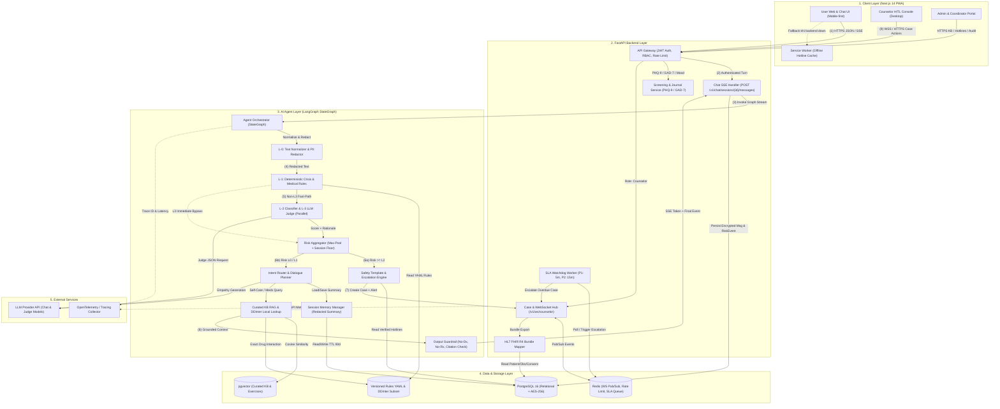
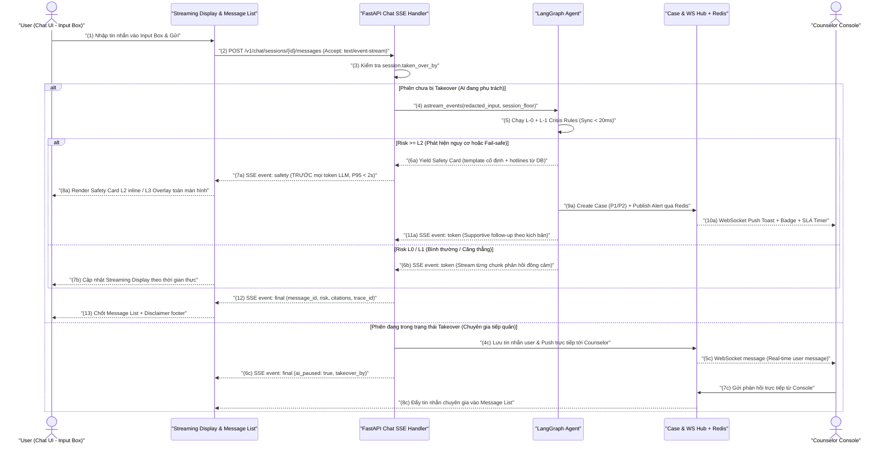
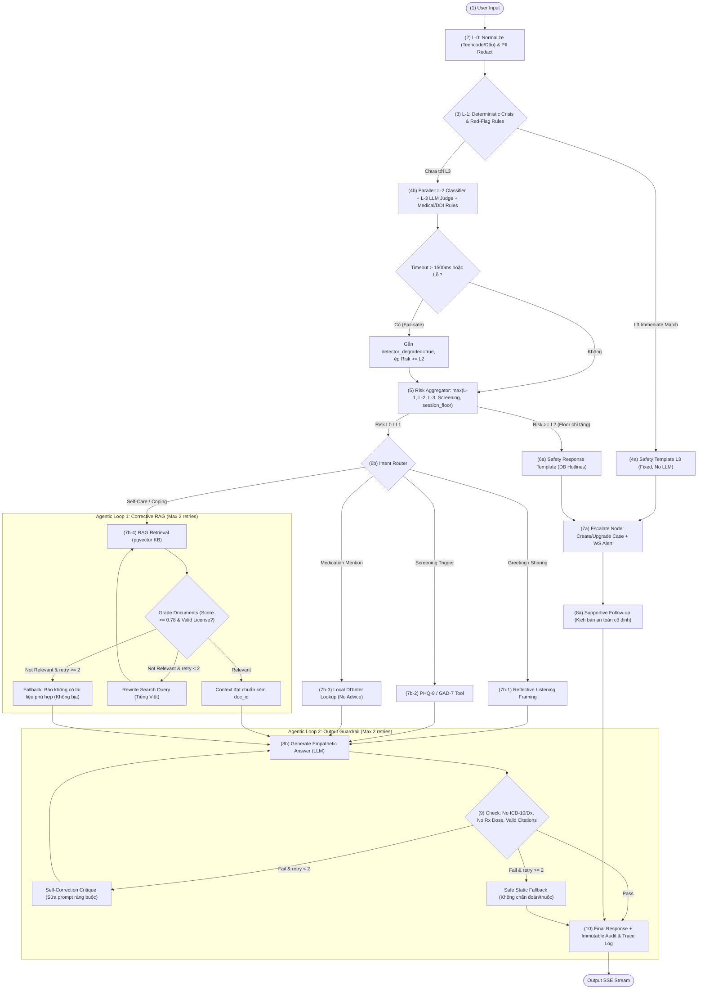
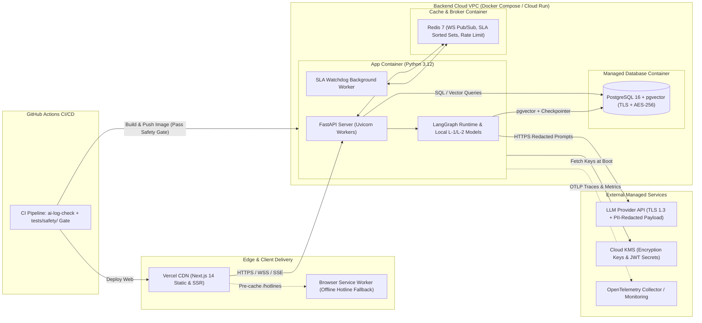

# 04 — KIẾN TRÚC HỆ THỐNG & HỒ SƠ QUYẾT ĐỊNH KIẾN TRÚC (ADR): BÌNH AN

| Trường | Giá trị |
|---|---|
| Phiên bản | v0.1 — Gate 1 |
| Ngày | 2026-11-15 |
| Owner | Senior Backend Engineer / Tech Lead |
| Reviewers | PM, AI Engineer, FE Lead, QA/Safety, Cố vấn lâm sàng |
| Liên quan | [Brief](01-BRIEF.md) · [PRD](02-PRD.md) · [Wireframe & UI Flow](03-WIREFRAME-UI-FLOW.md) |

**Quy ước nhãn:** `[FACT]` đã kiểm chứng · `[ASSUMPTION]` giả định · `[UNKNOWN]` cần làm rõ · `[UNVERIFIED]` chưa xác minh · `[ESTIMATE]` ước tính · `[SYNTHETIC]` dữ liệu giả lập.

> Tài liệu này cụ thể hóa kiến trúc Backend, luồng xử lý trạng thái LangGraph, thiết kế lưu trữ/bảo mật dữ liệu, chiến lược triển khai và các quyết định kiến trúc (ADR-001 đến ADR-006) cho dự án **Bình An (VMEC-20)**, tuân thủ tuyệt đối các bất biến an toàn trong [CLAUDE.md](../CLAUDE.md) và [PRD](02-PRD.md).

---

## 1. Sơ đồ Kiến trúc Hệ thống (Architecture Diagrams)

Tất cả sơ đồ dưới đây tuân thủ 5 quy tắc thiết kế kỹ thuật:
1. Tên node mô tả chính xác chức năng.
2. Phân nhóm rõ ranh giới hệ thống bằng `subgraph`.
3. Mũi tên có nhãn mô tả dữ liệu truyền qua.
4. Đánh số thứ tự `(1)`, `(2)`, `(3)`... trên các luồng tuần tự chính.
5. Mỗi diagram tách riêng một góc nhìn (Overview, Chat Streaming & HITL, Agent Flow, Deployment).

### 1.1 System Overview Diagram

Hiển thị bức tranh toàn cảnh từ Client, FastAPI Backend, LangGraph AI Agent, Data Layer đến External Services.



---

### 1.2 Thiết kế Chat Interface, SSE Streaming & WebSocket Takeover

Chi tiết tương tác thời gian thực giữa Chat UI (`Input Box` → `Streaming Display` → `Message List`), endpoint `POST /v1/chat/sessions/{id}/messages` (SSE), và `WebSocket /v1/ws/counselor` khi có khủng hoảng và tiếp quản phiên (Takeover).



---

### 1.3 Agent Flow Diagram — State Machine với LangGraph & Agentic Loops

Sơ đồ state machine của LangGraph thể hiện rõ **Safety-First Pre-LLM Gate** và **2 vòng lặp Agentic Loop** (Corrective RAG Loop và Output Guardrail Self-Correction Loop) — điểm khác biệt cốt lõi giữa Agent có phản xạ/tự sửa lỗi và một chuỗi chain tuyến tính đơn giản.



---

### 1.4 Deployment Diagram

Mô hình triển khai đề xuất cho môi trường demo Cloud (Singapore region `[ASSUMPTION]` — xem Open Question Q4 trong PRD).



---

## 2. Thiết kế Kỹ thuật Backend Cốt lõi (Senior Backend Deep-Dive)

### 2.1 Định nghĩa `AgentState` và Cưỡng chế Bất biến An toàn

Để tuân thủ 6 luật trong [CLAUDE.md](../CLAUDE.md) ngay ở tầng kiến trúc code, `AgentState` sử dụng custom reducer nhằm đảm bảo `session_risk_floor` là **đơn điệu không giảm (monotonically non-decreasing)** trong suốt vòng đời phiên (chỉ Counselor API mới có quyền reset khi đóng ca):

```python
from typing import Annotated, Literal, Optional, TypedDict
from operator import add

RiskLevel = Literal["L0", "L1", "L2", "L3"]
RISK_ORDER: dict[RiskLevel, int] = {"L0": 0, "L1": 1, "L2": 2, "L3": 3}

def monotonic_risk_reducer(current: RiskLevel, incoming: RiskLevel) -> RiskLevel:
    """Bất biến R1: Risk level của phiên chỉ tăng, không bao giờ tự giảm bởi AI."""
    return current if RISK_ORDER[current] >= RISK_ORDER[incoming] else incoming

class Citation(TypedDict):
    doc_id: str
    title: str
    source_url: str
    score: float

class AgentState(TypedDict):
    # Identity & Trace
    session_id: str
    user_id: str
    trace_id: str

    # Input processing (L-0)
    raw_message: str
    normalized_message: str
    redacted_message: str          # Bản đã xóa PII trước khi đi qua LLM
    recent_history_redacted: list[str]

    # Risk & Safety (L-1..L-4)
    session_risk_floor: Annotated[RiskLevel, monotonic_risk_reducer]
    turn_risk_level: RiskLevel
    triggered_rules: Annotated[list[str], add]
    classifier_score: Optional[float]
    llm_judge_output: Optional[dict]
    detector_degraded: bool        # True nếu L-2/L-3 timeout > 1500ms hoặc lỗi
    case_id: Optional[str]

    # RAG & Output Guardrail Loops
    intent: Literal["empathy", "self_care", "screening", "medication", "crisis"]
    rag_query: str
    rag_retry_count: int
    retrieved_citations: list[Citation]
    guardrail_retry_count: int
    guardrail_violations: list[str]

    # Final output
    safety_template_id: Optional[str]
    final_reply: str
```

**Cơ chế thực thi các luật cứng:**
- **Pre-LLM Gate:** Node `crisis_rules` (L-1) nhận `normalized_message` và chạy hoàn toàn bằng regex/Aho-Corasick trên CPU trước bất kỳ lời gọi mạng nào ra LLM.
- **No LLM Hotline Generation:** `safety_response` chỉ thực hiện `SELECT name, phone, hours, scope FROM hotlines WHERE is_active = TRUE` và format vào template `safety_templates` đã được Cố vấn lâm sàng ký duyệt; LLM không có tool hoặc biến ngữ cảnh để sửa số điện thoại.
- **Zero Bypass Edge:** Graph compile chỉ cho phép cạnh `risk_aggregate` → `safety_response` → `escalate` khi `turn_risk_level in ("L2", "L3")`.

---

### 2.2 Ngân sách Độ trễ (Latency Budget) & Fail-safe Circuit Breaker

Đáp ứng NFR trong PRD §8 (`Safety Card P95 < 2000ms` `[ESTIMATE]` và `First Token P95 < 1500ms` `[ESTIMATE]`):

| Giai đoạn xử lý | Thành phần | Budget P95 `[ESTIMATE]` | Chiến lược tối ưu & Fail-safe |
|---|---|---:|---|
| 1. Auth, Session Load & Takeover Check | FastAPI + Redis | 25 ms | Cache trạng thái `taken_over_by` và `session_risk_floor` trong Redis Hash. |
| 2. L-0 Normalize & PII Redact | CPU (Regex + NER nhẹ) | 20 ms | Chạy in-process không gọi mạng; khôi phục dấu tiếng Việt cho teencode. |
| 3. L-1 Deterministic Crisis & Red-Flag Rules | CPU (Compiled Regex) | 15 ms | Nếu match L3 → cắt mạch ngay tại mốc ~60 ms, phát `event: safety` xuống SSE. |
| 4. L-2 Classifier + L-3 LLM Judge + DDI (Song song) | `asyncio.gather` + Timeout | ≤ 1,500 ms | Hard timeout `CRISIS_DETECTOR_TIMEOUT_MS=1500`. Nếu timeout/exception → set `detector_degraded=True`, ép `turn_risk_level >= "L2"`, mở Safety Card ngay. |
| 5. Escalate DB Write & WS Alert | Postgres + Redis Pub/Sub | 100 ms | `INSERT INTO cases` + `risk_events` trong 1 transaction, phát WS event bất đồng bộ không chặn SSE stream. |
| **Tổng cộng tới Safety Card (L2/L3)** | **End-to-End** | **~160 ms (L-1) / ~1,660 ms (L-2/L-3)** | Đạt ngưỡng `< 2,000 ms` ngay cả ở trường hợp xấu nhất khi LLM Judge timeout. |

---

### 2.3 Thiết kế Cơ sở Dữ liệu, Indexing & Bảo mật Cấp Trường

Mở rộng lược đồ dữ liệu trong PRD §6.1 với các quyết định cài đặt ở tầng PostgreSQL 16:

1. **Ràng buộc bất biến (Append-only Enforcement):**
   - Áp dụng PostgreSQL `BEFORE UPDATE OR DELETE` trigger ném exception trên 3 bảng: `risk_events`, `consents`, `audit_log`. Ngay cả tài khoản ứng dụng Backend cũng chỉ được cấp quyền `SELECT, INSERT` trên 3 bảng này (Principle of Least Privilege).
2. **Chiến lược Đánh chỉ mục (Indexing Strategy):**
   - **Vector Search (`kb_chunks`):** `CREATE INDEX idx_kb_chunks_hnsw ON kb_chunks USING hnsw (embedding vector_cosine_ops) WITH (m = 16, ef_construction = 64);` — tối ưu tốc độ truy vấn cosine similarity P95 < 15 ms `[ESTIMATE]` cho tập KB < 10k chunks mà không cần re-train như IVFFlat.
   - **Hàng đợi Chuyên gia (`cases`):** Partial Composite Index `CREATE INDEX idx_cases_active_queue ON cases (priority ASC, sla_due_at ASC) WHERE status IN ('NEW', 'ESCALATED');` giúp truy vấn hàng đợi theo độ ưu tiên và SLA đếm ngược giữ độ phức tạp ổn định bất kể số ca đã đóng tăng lên.
   - **Audit & Traceability (`risk_events`):** Index trên `(session_id, ts DESC)` và `trace_id`.
3. **Mã hóa & Break-glass PII Access:**
   - Các cột nhạy cảm (`messages.content_enc`, `journal_entries.note_enc`, `emergency_contacts.phone_enc`) được mã hóa ở tầng ứng dụng bằng **AES-256-GCM** với khóa từ `FIELD_ENCRYPTION_KEY` (hoặc Cloud KMS envelope encryption) trước khi `INSERT`.
   - Cột `messages.content_redacted` lưu bản đã che PII (`[NAME]`, `[PHONE]`, `[ID_NUM]`, `[EMAIL]`) phục vụ AI Agent và tóm tắt cho chuyên gia.
   - Khi chuyên gia bấm **"Break-glass"** xem nội dung giải mã cho ca L3, endpoint yêu cầu trường `reason` tối thiểu 10 ký tự, ghi đồng thời vào `audit_log` và `case_events` **trong cùng một transaction** trước khi trả payload giải mã.

---

### 2.4 Quản lý Trạng thái Takeover & SLA Watchdog

- **Takeover Atomic Lock:** Khi Counselor gọi `POST /v1/cases/{id}/takeover`, hệ thống cập nhật `chat_sessions.taken_over_by = counselor_id` trong Postgres và ghi đồng thời key `session:{id}:takeover` vào Redis. Ở mọi tin nhắn tiếp theo, `ChatAPI` kiểm tra cờ này trước khi khởi chạy LangGraph để đảm bảo AI ngưng trả lời tức thì, tránh hiện tượng hai luồng (AI và người thật) nhắn chen nhau.
- **SLA Watchdog Worker:** Sử dụng Redis Sorted Set `sla:deadlines` với score là Unix timestamp của `sla_due_at` (`+5m` cho P1/L3, `+15m` cho P2/L2). Background worker quét các phần tử có `score <= now()` mỗi 5 giây: nếu `cases.status == 'NEW'`, chuyển sang `ESCALATED`, ghi `case_events`, và đẩy WebSocket alert tới toàn bộ điều phối viên & chuyên gia dự phòng.

---

## 3. Hồ sơ Quyết định Kiến trúc (Architecture Decision Records — ADR)

### ADR-001: Kiến trúc phát hiện khủng hoảng lai đa lớp (Hybrid Tiered Crisis Detection)

* **Ngày:** 2026-11-15
* **Trạng thái:** Accepted

#### Bối cảnh (Context)
Bình An phục vụ người dùng có nguy cơ khủng hoảng tâm lý (ý định tự hại/tự tử). Yêu cầu từ PRD §3 và §8 đòi hỏi: phát hiện đa sắc thái tiếng Việt (bao gồm không dấu, teencode, nói vòng, phủ định), tỷ lệ Recall L3 đạt 100%, L2+ ≥ 98%, thời gian hiển thị Safety Card P95 < 2s, và hệ thống không được im lặng nếu LLM gặp sự cố (fail-safe). Cần quyết định cơ chế phát hiện khủng hoảng tối ưu.

#### Các lựa chọn (Alternatives)

* **Lựa chọn 1: Hybrid Tiered Detection (L-0 Chuẩn hóa → L-1 Deterministic Rules → Song song L-2 Classifier + L-3 LLM Judge → Max-Pool + Fail-Safe)**
  * *Ưu điểm:* L-1 cho độ trễ < 20ms và recall tuyệt đối với từ khóa rõ ràng/cờ đỏ y khoa; L-2/L-3 chạy song song xử lý ngữ cảnh nhiều lượt, teencode, câu phủ định và trích dẫn lời bài hát; đảm bảo fail-safe khi LLM down/timeout.
  * *Nhược điểm:* Kiến trúc nhiều thành phần hơn, cần bảo trì bộ rule YAML và đồng bộ versioning giữa rule, classifier và judge.

* **Lựa chọn 2: Chỉ dùng LLM (Single Prompt / LLM-as-a-Judge) cho mọi lượt chat**
  * *Ưu điểm:* Triển khai cực nhanh, code ít, chỉ cần một lời gọi API.
  * *Nhược điểm:* Độ trễ cao (dễ vượt ngưỡng 2s), chi phí token lớn cho 100% tin nhắn thường, điểm lỗi đơn (SPOF) khi LLM provider gián đoạn hoặc bị rate-limit, dễ bị tấn công prompt injection/jailbreak làm lọt ca L3.

* **Lựa chọn 3: Chỉ dùng Keyword/Regex truyền thống**
  * *Ưu điểm:* Chi phí bằng 0, tốc độ dưới 5ms, xác định (deterministic) 100%.
  * *Nhược điểm:* Không phân biệt được câu phủ định ("mình không có ý định tự tử đâu") dẫn đến báo động giả làm chuyên gia quá tải; bỏ sót các câu nói vòng/ẩn dụ ("muốn ngủ một giấc không bao giờ dậy") hoặc leo thang qua nhiều lượt.

#### Quyết định (Decision)
Chọn **Lựa chọn 1: Kiến trúc phát hiện khủng hoảng lai đa lớp (Hybrid Tiered Detection)** kết hợp cơ chế `max-pooling` và `session_risk_floor` đơn điệu tăng.

#### Lý do (Rationale)
1. Tách được **luồng an toàn cốt lõi** (L-0 + L-1 chạy đồng bộ trước LLM) để đảm bảo các ca L3 rõ ràng nhận Safety Card chỉ trong ~160ms.
2. Kết hợp L-2 (encoder tiếng Việt) và L-3 (LLM Judge ngữ cảnh 5–10 lượt) giúp cân bằng giữa **Recall ≥ 98%** và **Precision ≥ 0.60** (PRD §9.2), giảm gánh nặng báo động giả cho Counselor Console.
3. Khả năng gắn `detector_degraded=true` và tự động nâng ngưỡng hiển thị tài nguyên an toàn khi L-2/L-3 quá `1500ms` giúp thực thi triệt để nguyên tắc N4 (Fail-safe).

#### Hệ quả (Consequences)
- Phải xây dựng bộ test regression `tests/safety/` (~300 ca `[SYNTHETIC]`) kiểm thử đầy đủ cả 4 lớp và kịch bản timeout/chaos test trước mỗi lần merge.
- Mỗi sự kiện trong bảng `risk_events` bắt buộc lưu `rule_ids` và `model_versions` để truy vết nguyên nhân (reproducibility) khi có false positive/false negative.

---

### ADR-002: Chọn LangGraph làm AI Agent Orchestration Framework

* **Ngày:** 2026-11-15
* **Trạng thái:** Accepted

#### Bối cảnh (Context)
Luồng xử lý của Bình An không phải là một chuỗi hỏi-đáp tuyến tính: hệ thống cần rẽ nhánh có điều kiện theo risk level, bắt buộc đi qua `escalate` khi `risk >= L2`, có các **agentic loops** (viết lại query RAG khi tài liệu không đạt chuẩn, tự sửa lỗi khi Output Guardrail phát hiện dấu hiệu chẩn đoán/kê thuốc), và cần cơ chế kiểm toán (auditability) chặt chẽ cho bài toán y tế.

#### Các lựa chọn (Alternatives)

* **Lựa chọn 1: LangGraph (`StateGraph`)**
  * *Ưu điểm:* Mô hình hóa tường minh dưới dạng đồ thị có hướng (nodes, conditional edges, cycles); dễ cưỡng chế bất biến chuyển trạng thái (không tạo được đường tắt bỏ qua `escalate`); hỗ trợ native streaming event và state checkpointing theo `session_id`.
  * *Nhược điểm:* Đường cong học tập cao hơn chain đơn giản; cần thiết kế `AgentState` và reducer cẩn thận ngay từ đầu.

* **Lựa chọn 2: LangChain Chains / LCEL tuyến tính**
  * *Ưu điểm:* Quen thuộc, viết nhanh cho pipeline RAG một chiều.
  * *Nhược điểm:* Rất khó biểu diễn vòng lặp có điều kiện (Corrective RAG, Output Guardrail retry) và khó kiểm soát/audit luồng rẽ nhánh phức tạp khi kết hợp song song L-2/L-3 và HITL.

* **Lựa chọn 3: Tự viết Custom Python Async State Machine**
  * *Ưu điểm:* Không phụ thuộc framework ngoài, kiểm soát 100% bộ nhớ và hiệu năng.
  * *Nhược điểm:* Tốn thời gian xây dựng lại cơ chế event streaming cho từng node, state persistence, và công cụ debug/tracing trong khung thời gian hackathon (Sprint 1–3).

#### Quyết định (Decision)
Chọn **Lựa chọn 1: LangGraph (`StateGraph`)**.

#### Lý do (Rationale)
1. Đồ thị tường minh khớp 1-1 với sơ đồ luồng an toàn trong PRD §5.2, giúp mentor, QA và cố vấn lâm sàng đọc và kiểm chứng không có lỗ hổng logic.
2. Hỗ trợ tự nhiên các **agentic loops** (giới hạn `retry < 2`) mà vẫn kiểm soát chặt chẽ chi phí token và độ trễ.
3. Tích hợp sẵn streaming từng bước (`astream_events`) giúp FastAPI đẩy `event: safety` xuống SSE ngay sau node `crisis_rules` mà không phải đợi toàn bộ graph kết thúc.

#### Hệ quả (Consequences)
- Team cần chuẩn hóa contract `AgentState` (Mục 2.1) trước khi code các node ở Sprint 1.
- Phụ thuộc vào hệ sinh thái LangGraph; cần pin version cụ thể trong `pyproject.toml` và viết unit test độc lập cho logic từng node để dễ tách rời nếu cần.

---

### ADR-003: Hợp nhất Cơ sở dữ liệu Quan hệ và Vector bằng PostgreSQL + `pgvector`

* **Ngày:** 2026-11-15
* **Trạng thái:** Accepted

#### Bối cảnh (Context)
Hệ thống cần lưu trữ dữ liệu quan hệ có tính ACID và audit nghiêm ngặt (`users`, `consents`, `cases`, `risk_events`, `hotlines`) đồng thời cần tìm kiếm ngữ nghĩa (vector similarity) trên kho bài tập tự chăm sóc & tài liệu CBT đã duyệt (`kb_chunks`, ước tính < 10,000 chunks `[ESTIMATE]`). Cần lựa chọn kiến trúc Database phù hợp cho cả hiệu năng, bảo mật và tốc độ vận hành của team 4–6 người.

#### Các lựa chọn (Alternatives)

* **Lựa chọn 1: PostgreSQL 16 + Extension `pgvector` (Single Database)**
  * *Ưu điểm:* Một hệ quản trị duy nhất cho cả dữ liệu quan hệ, audit bất biến (trigger) và vector search; join trực tiếp metadata nguồn/license (`kb_documents`) với vector (`kb_chunks`) trong một câu SQL; giảm tải hạ tầng Docker/Cloud.
  * *Nhược điểm:* Hiệu năng tìm kiếm vector ở quy mô hàng chục triệu vectors không bằng vector DB chuyên dụng phân tán.

* **Lựa chọn 2: Tách SQLite (hoặc Postgres) + ChromaDB riêng**
  * *Ưu điểm:* ChromaDB dễ khởi tạo nhanh trong script Python thử nghiệm cục bộ.
  * *Nhược điểm:* Tốn thêm container vận hành; tách rời dữ liệu gây nguy cơ lệch đồng bộ (khi Admin vô hiệu hóa một tài liệu KB ở Postgres nhưng vector ở ChromaDB chưa kịp xóa); SQLite không phù hợp cho ghi đồng thời từ nhiều worker FastAPI và thiếu cơ chế RBAC/Trigger chặt chẽ.

* **Lựa chọn 3: PostgreSQL + Managed Cloud Vector DB (Pinecone)**
  * *Ưu điểm:* Managed hoàn toàn, scale rất lớn.
  * *Nhược điểm:* Dữ liệu KB/truy vấn đi qua thêm một bên thứ 3 (tăng latency mạng và bề mặt tuân thủ dữ liệu y tế), phát sinh thêm chi phí và quản lý API key.

#### Quyết định (Decision)
Chọn **Lựa chọn 1: PostgreSQL 16 + `pgvector`**.

#### Lý do (Rationale)
1. Quy mô kho tri thức đã duyệt của Bình An dự kiến < 10,000 chunks (`[ESTIMATE]`); với HNSW index trên `pgvector`, độ trễ truy vấn dư sức đạt < 15ms ngay trong VPC nội bộ.
2. Đảm bảo tính nhất quán tuyệt đối (ACID): chỉ một câu lệnh `JOIN` lọc `kb_documents.status = 'APPROVED'` là có ngay vector hợp lệ kèm `source_url` để gắn citation 100% chính xác (KPI PRD §7).
3. Hỗ trợ đầy đủ trigger `append-only`, partial index cho hàng đợi SLA và chuẩn bị sẵn sàng cho các yêu cầu lưu trữ dữ liệu tại chỗ (on-premise / region VN nếu cần).

#### Hệ quả (Consequences)
- Môi trường dev cục bộ (Docker Compose) và cloud managed DB bắt buộc phải cài đặt extension `pgvector`.
- Nếu trong tương lai tập KB vượt quá 1 triệu chunks `[ESTIMATE]`, cần cấu hình read-replica hoặc tách riêng vector index service.

---

### ADR-004: Giao thức truyền tải lai — SSE cho Chat Streaming và WebSocket cho HITL Console

* **Ngày:** 2026-11-15
* **Trạng thái:** Accepted

#### Bối cảnh (Context)
Hệ thống có hai luồng giao tiếp thời gian thực với đặc tính rất khác nhau:
1. **User Chat UI:** Người dùng gửi tin nhắn và cần nhận phản hồi AI theo từng token (< 1.5s), đặc biệt phải nhận được `Safety Card` trước mọi token nếu phát hiện khủng hoảng (< 2s).
2. **Counselor Console:** Chuyên gia cần nhận cảnh báo ca mới đẩy xuống từ server (< 3s), đồng thời thực hiện tương tác 2 chiều liên tục khi `Takeover` (chat trực tiếp với user qua lại nhiều lượt và cập nhật trạng thái SLA).

#### Các lựa chọn (Alternatives)

* **Lựa chọn 1: Lai SSE (cho User Chat Streaming) + WebSocket (cho Counselor Console & Takeover)**
  * *Ưu điểm:* SSE chạy trên HTTP chuẩn, tương thích tốt với các reverse proxy/serverless/mobile network chập chờn, tự động reconnect, dễ định nghĩa event có cấu trúc (`event: safety`, `event: token`, `event: final`); WebSocket đáp ứng hoàn hảo giao tiếp hai chiều độ trễ thấp cho Counselor Console.
  * *Nhược điểm:* Backend phải duy trì 2 cơ chế kết nối khác nhau (`StreamingResponse` cho SSE và Connection Manager + Redis Pub/Sub cho WS).

* **Lựa chọn 2: Dùng WebSocket cho toàn bộ cả User lẫn Counselor**
  * *Ưu điểm:* Đồng nhất một giao thức duy nhất.
  * *Nhược điểm:* Tốn tài nguyên giữ kết nối stateful cho hàng loạt user ẩn danh chỉ nhắn vài tin rồi thoát; khó tận dụng HTTP middleware (rate-limit theo endpoint, auth header chuẩn) và dễ bị ngắt bởi mạng di động/corporate firewall.

* **Lựa chọn 3: REST Polling (Short/Long Polling) cho cả hai phía**
  * *Ưu điểm:* Đơn giản nhất phía server.
  * *Nhược điểm:* Không thể stream token mượt mà (trải nghiệm người dùng kém khi đang căng thẳng); polling liên tục gây lãng phí DB I/O và khó đảm bảo cảnh báo ca P1 tới chuyên gia dưới 3 giây.

#### Quyết định (Decision)
Chọn **Lựa chọn 1: SSE cho Chat Streaming và WebSocket cho Counselor HITL Console**.

#### Lý do (Rationale)
1. Khớp trực tiếp với API Contract trong PRD §7 (`POST /v1/chat/sessions/{id}/messages` trả SSE và `WS /v1/ws/counselor`).
2. Cho phép gửi event `safety` làm gói tin đầu tiên ngay trên stream HTTP của chính request người dùng vừa gửi — triệt tiêu rủi ro lệch thứ tự gói tin giữa các kênh khác nhau.
3. Trong giai đoạn Takeover, tin nhắn từ Counselor qua WebSocket được đẩy tới User thông qua SSE/event stream chuyên biệt hoặc kênh nhận của phiên mà không cần nâng cấp toàn bộ ứng dụng user lên WebSocket ngay từ đầu.

#### Hệ quả (Consequences)
- Cần cấu hình `X-Accel-Buffering: no` ở reverse proxy (Nginx/Cloudflare/Vercel) để SSE không bị buffer gây trễ token hoặc trễ Safety Card.
- Cần triển khai Redis Pub/Sub làm message broker để đồng bộ WebSocket giữa nhiều worker FastAPI khi scale ngang (horizontal scaling).

---

### ADR-005: Chiến lược truy xuất tri thức — Curated Local KB (`pgvector`) + Offline DDInter thay vì Live Web Search API (Tavily / Serper.dev / Google Search)

* **Ngày:** 2026-11-15
* **Trạng thái:** Accepted

#### Bối cảnh (Context)
Bình An cần cung cấp bài tập tự chăm sóc (thở, CBT nền tảng, grounding) có trích dẫn nguồn, cảnh báo tương tác thuốc (DDI) và số đường dây nóng hỗ trợ khủng hoảng. Trong các hệ thống AI Agent thông thường, hay dùng Live Web Search API (như Tavily Search API, Serper.dev, Google Custom Search) để tìm thông tin thời gian thực. Tuy nhiên, PRD §5 (N5) và §7 đặt yêu cầu bắt buộc: **0 số hotline bị bịa**, **100% gợi ý bài tập từ KB đã duyệt**, và **không đưa lời khuyên y khoa sai**. Cần quyết định nguồn dữ liệu truy xuất cho Agent ở runtime.

#### Các lựa chọn (Alternatives)

* **Lựa chọn 1: Curated Local KB (`pgvector`) + Local DDInter Subset (Chặn hoàn toàn Live Web Search ở runtime)**
  * *Ưu điểm:* 100% nội dung bài tập, số hotline (`hotlines` DB) và tương tác thuốc (`DDInter` local) đã được kiểm duyệt bản quyền và chuyên môn trước khi vào DB; loại bỏ rủi ro SEO rác/nguồn y khoa độc hại từ Internet; độ trễ nội bộ < 20ms và không bị rate-limit/down bởi bên thứ 3 lúc nửa đêm.
  * *Nhược điểm:* Tri thức không tự động cập nhật tin tức thời sự mới hằng ngày; cần quy trình Admin/Cố vấn lâm sàng duyệt và ingest tài liệu định kỳ.

* **Lựa chọn 2: Tavily Search API (Live Web Search ở runtime)**
  * *Ưu điểm:* Tối ưu cho AI Agent, kết quả đã clean và structured, tích hợp sẵn với hệ sinh thái LangChain/LangGraph, free tier 1,000 requests/tháng đủ cho demo.
  * *Nhược điểm:* Không kiểm soát được nguồn y tế trả về (có thể trả về blog chưa kiểm chứng, số điện thoại giả mạo/hết hạn, hoặc bài viết khuyên tự ý dùng thuốc — vi phạm trực tiếp quy tắc N1 và N5); tăng thêm độ trễ mạng 0.8–2s và tạo thêm một điểm lỗi phụ thuộc bên ngoài (SPOF) khi Tavily gián đoạn.

* **Lựa chọn 3: Serper.dev / Google Custom Search API (Live Web Search ở runtime)**
  * *Ưu điểm:* Bao phủ dữ liệu Google Search rộng, ổn định.
  * *Nhược điểm:* Cần parse kết quả thủ công, chịu rủi ro rate-limit (Google Custom Search free tier chỉ 100 requests/ngày), và mang toàn bộ rủi ro an toàn lâm sàng tương tự Lựa chọn 2 khi Agent đọc trực tiếp nội dung web mở chưa qua thẩm định (bao gồm cả nguy cơ **Indirect Prompt Injection** từ trang web bên ngoài).

#### Quyết định (Decision)
Chọn **Lựa chọn 1: Curated Local KB (`pgvector`) + Local DDInter Subset** cho runtime của Agent. *(Ghi chú: Có thể sử dụng Tavily Search API ở pipeline offline dành riêng cho Admin/Cố vấn lâm sàng tìm kiếm tài liệu WHO/NHS/NIMH để thẩm định trước khi nạp vào KB, tuyệt đối không cấp tool tìm web cho Agent khi chat với người dùng).*

#### Lý do (Rationale)
1. An toàn lâm sàng và độ tin cậy của thông tin (Groundedness) quan trọng hơn độ rộng thông tin: Bình An là trợ lý sức khỏe tinh thần ban đầu, không phải công cụ tìm kiếm tin tức thời sự.
2. Bảo đảm KPI cứng: **0 hotline bị bịa** và **100% trích dẫn trỏ về `doc_id` hợp lệ** (PRD §9.2).
3. Triệt tiêu bề mặt tấn công Indirect Prompt Injection từ các trang web bên ngoài và giảm chi phí/latency cho mỗi lượt hỏi đáp.

#### Hệ quả (Consequences)
- Khi câu hỏi người dùng không tìm được tài liệu phù hợp trong `pgvector` (score < ngưỡng sau 2 vòng Corrective RAG), Agent bắt buộc trả lời trung thực là chưa có tài liệu phù hợp (Honest Fallback), không được tự bịa hoặc tìm web thay thế.
- Cần xây dựng màn hình Admin quản lý KB (A2) và quy trình Admin re-verify bảng `hotlines` mỗi 30 ngày (PRD §3.3).

---

### ADR-006: Bảo mật PII/PHI bằng Pre-LLM Redaction, Mã hóa Cột AES-256 và Bảng `risk_events` Append-Only

* **Ngày:** 2026-11-15
* **Trạng thái:** Accepted

#### Bối cảnh (Context)
Dữ liệu sức khỏe tinh thần là dữ liệu cá nhân nhạy cảm theo Nghị định 13/2023/NĐ-CP `[FACT]`. Hệ thống phải gọi LLM Provider bên ngoài (external API) để phân tích ngữ cảnh và tạo câu trả lời đồng cảm, đồng thời phải hỗ trợ quyền xóa dữ liệu của người dùng (`DELETE /v1/me`) nhưng vẫn giữ được dấu vết kiểm toán an toàn khi có sự cố khủng hoảng (PRD §4 E1-4, E4-3, §6.3).

#### Các lựa chọn (Alternatives)

* **Lựa chọn 1: Pre-LLM PII Redaction + Mã hóa cấp cột (AES-256-GCM) + Bảng `risk_events` Append-Only tách biệt**
  * *Ưu điểm:* Không gửi dữ liệu định danh (tên thật, SĐT, email, CCCD, nơi học/làm) ra khỏi biên hệ thống tới LLM Provider; hỗ trợ hard-delete dữ liệu cá nhân trong `users`/`messages`/`journal_entries` khi user yêu cầu nhưng vẫn bảo toàn nguyên vẹn thống kê an toàn ẩn danh ở `risk_events`; chuyên gia mặc định chỉ thấy bản redacted và phải mở khóa break-glass có audit log khi gặp L3.
  * *Nhược điểm:* Bộ redaction tiếng Việt có thể che nhầm một số danh từ riêng thông thường (ảnh hưởng nhẹ đến ngữ cảnh của LLM); tăng độ phức tạp khi thực hiện mã hóa/giải mã ở tầng repository.

* **Lựa chọn 2: Gửi văn bản gốc qua HTTPS tới LLM Provider và dùng toàn bộ DB encryption mặc định (TDE)**
  * *Ưu điểm:* Cài đặt đơn giản, không cần logic redact hay mã hóa cấp ứng dụng.
  * *Nhược điểm:* Vi phạm nguyên tắc bảo mật PII/PHI (N6): SĐT/tên/trường học của người dùng bị truyền tới máy chủ của LLM Provider bên thứ 3; nếu lộ quyền truy cập DB (SQL read/backup dump), toàn bộ nội dung nhật ký và tin nhắn đọc được trực tiếp dạng plaintext.

* **Lựa chọn 3: Tự host toàn bộ mô hình LLM lớn (Self-hosted 70B+) để khỏi phải redact PII**
  * *Ưu điểm:* Dữ liệu không rời khỏi VPC.
  * *Nhược điểm:* Chi phí GPU hạ tầng rất cao, vượt quá ngân sách và khả năng vận hành của giai đoạn MVP / hackathon; vẫn không giải quyết được vấn đề bảo mật nội bộ (chuyên gia/admin đọc plaintext khi không cần thiết) và xung đột giữa `DELETE /v1/me` với audit log.

#### Quyết định (Decision)
Chọn **Lựa chọn 1: Pre-LLM PII Redaction + Mã hóa Cột AES-256-GCM + Bảng `risk_events` Append-Only**.

#### Lý do (Rationale)
1. Thực thi triệt để nguyên tắc **Privacy by Design** và tuân thủ trực tiếp PRD §6.3 + N6.
2. Giải quyết gọn mâu thuẫn giữa quyền "Được lãng quên / Xóa dữ liệu" (`DELETE /v1/me`) và yêu cầu "Audit an toàn bất biến" (`risk_events` chỉ lưu `level`, `layers_json`, `rule_ids`, `model_versions` ở dạng ẩn danh hoàn toàn, không chứa FK cứng ràng buộc giữ lại định danh cá nhân sau khi xóa).
3. Cơ chế **Break-glass** giúp cân bằng giữa quyền riêng tư của người dùng L0–L2 và nhu cầu cứu hộ khẩn cấp cho ca L3.

#### Hệ quả (Consequences)
- Phải xây dựng bộ test đơn vị cho `pii_redact` đảm bảo không làm hỏng từ khóa khủng hoảng (ví dụ: không che nhầm số `115` hay tên thuốc thành `[PHONE]`/`[NAME]`).
- Khóa mã hóa `FIELD_ENCRYPTION_KEY` và `JWT_SECRET` bắt buộc quản lý qua biến môi trường / Cloud KMS, tuyệt đối không commit vào git.
- Trong giai đoạn phát triển và demo, toàn bộ dữ liệu test phải là dữ liệu giả lập `[SYNTHETIC]`.

---

## 4. Điểm cần làm rõ & Kế hoạch Kiểm chứng Kiến trúc `[UNKNOWN / NEXT STEPS]`

| # | Hạng mục | Trạng thái | Hành động đề xuất ở Sprint 1 |
|---|---|---|---|
| 1 | Yêu cầu cư trú dữ liệu (Data Residency) tại VN hay Singapore `[UNKNOWN]` | Mở (PRD Q4) | Tech Lead & Mentor chốt trước khi provision Managed Postgres. |
| 2 | Model Embedding & LLM tiếng Việt tối ưu cho L-2/L-3 + Chat | `[ASSUMPTION]` | Benchmark 50 truy vấn mẫu và bộ 300 ca `[SYNTHETIC]` để chốt model đạt P95 < 1.5s. |
| 3 | Chaos Test cho kịch bản LLM Provider down | Kế hoạch | Viết test tích hợp mô phỏng timeout > 1500ms trong `tests/safety/` để chứng minh Safety Card vẫn hiện < 2s. |
| 4 | Tích hợp Offline Hotline Cache (`Service Worker`) | Chưa có ở demo | FE + BE thống nhất endpoint tĩnh `/hotlines.json` được ký cache ở SW. |
